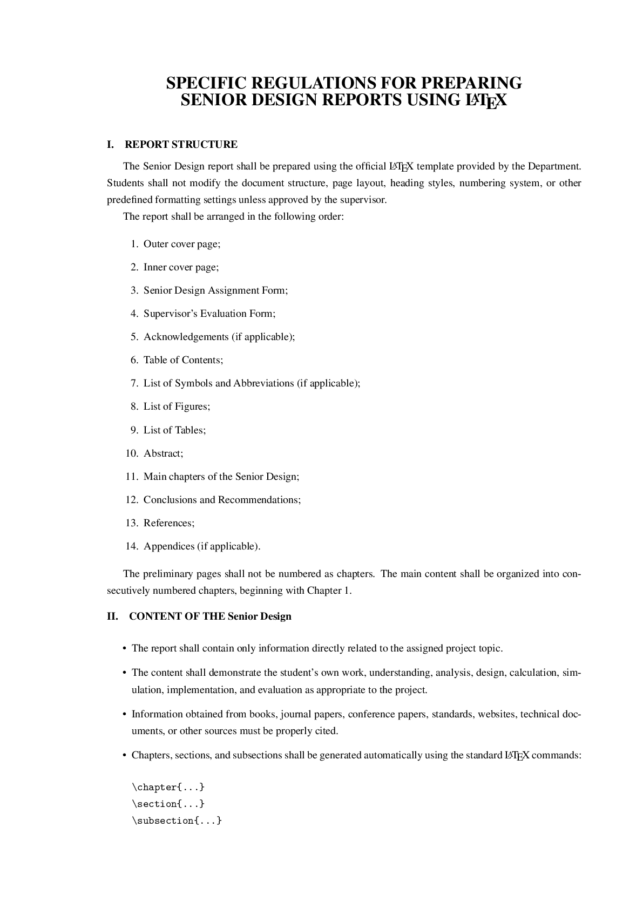

# LaTeX-ĐAMH

[](https://github.com/Ex6TenZ13/LaTeX-DAMH/actions/workflows/latex.yml)

[](https://github.com/Ex6TenZ13/LaTeX-DAMH/blob/main/Quyen_DAMH.pdf)

Nhấn vào ảnh xem trước để mở PDF trực tiếp trên GitHub. Các bản PDF đã phát hành
có tại trang [Releases](https://github.com/Ex6TenZ13/LaTeX-DAMH/releases/latest).

## Cài đặt trên Windows

1. Cài [MiKTeX](https://miktex.org/download) bằng **Basic MiKTeX Installer**.
   Nên chọn cài cho người dùng hiện tại, đặt khổ giấy A4 và chọn **Always** hoặc
   **Ask me first** để MiKTeX cài các package còn thiếu. Sau khi cài, mở
   **MiKTeX Console**, chọn **Updates** và cập nhật toàn bộ package.
2. Cài [TeXstudio](https://texstudio.org/) bằng bản Windows Installer. Mở
   **Options → Configure TeXstudio → Build**, chọn **PdfLaTeX** làm trình biên
   dịch mặc định. Mở `Quyen_ĐAMH.tex`, sau đó dùng **Build & View** (`F5`).
3. Cài [SumatraPDF](https://www.sumatrapdfreader.org/download-free-pdf-viewer).
   Để dùng SumatraPDF thay trình xem tích hợp, vào **Options → Configure
   TeXstudio → Commands** và đặt lệnh External PDF Viewer:

   ```text
   "C:/Program Files/SumatraPDF/SumatraPDF.exe" -reuse-instance -forward-search "?c:am.tex" @ "?am.pdf"
   ```

   Trong SumatraPDF, nhấn `Ctrl+K`, chọn **Set Inverse Search Command Line** và
   nhập:

   ```text
   "C:\Program Files\TeXstudio\texstudio.exe" "%f" -line %l
   ```

Nếu TeXstudio báo thiếu package, mở MiKTeX Console để cập nhật hoặc cho phép
MiKTeX cài package tự động, rồi build lại.

## Gói nguồn của release

Mỗi release chứa `Quyen_DAMH.pdf` và `LaTeX-DAMH-source.zip`. File ZIP được tạo
trực tiếp từ commit của tag bằng `git archive`; README, thư mục `.git` và các file
build tạm không nằm trong gói.

